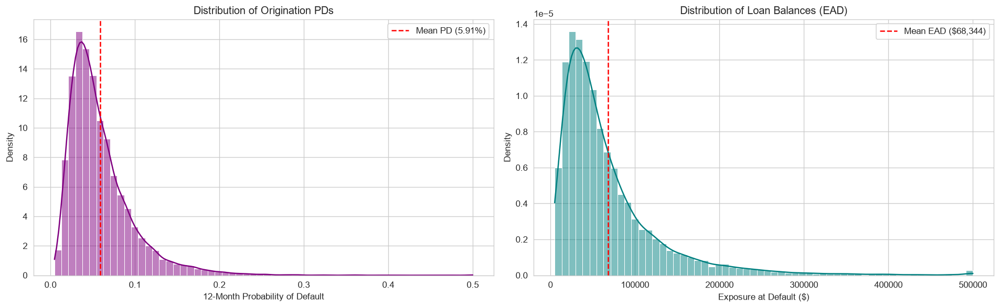
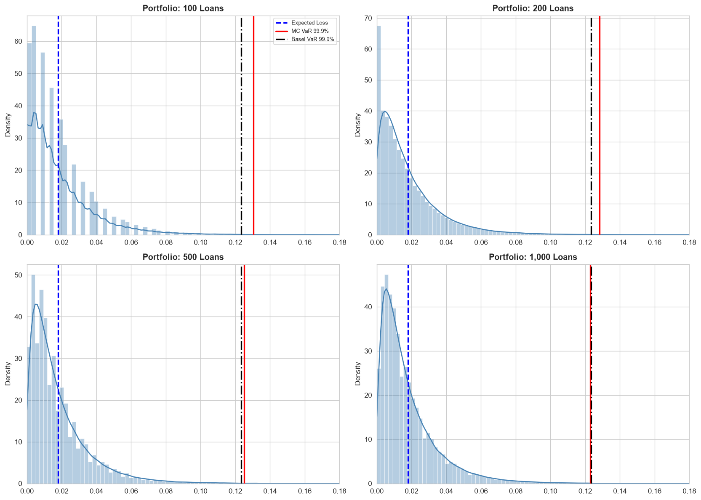
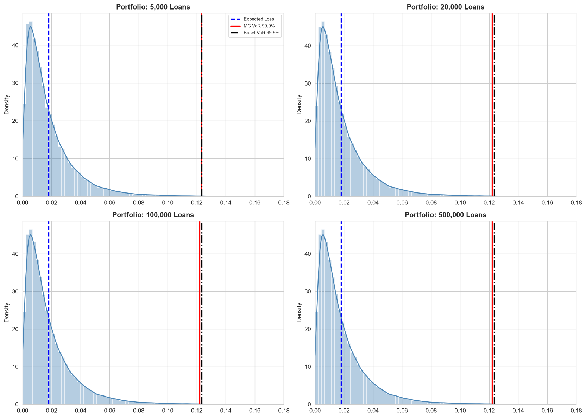
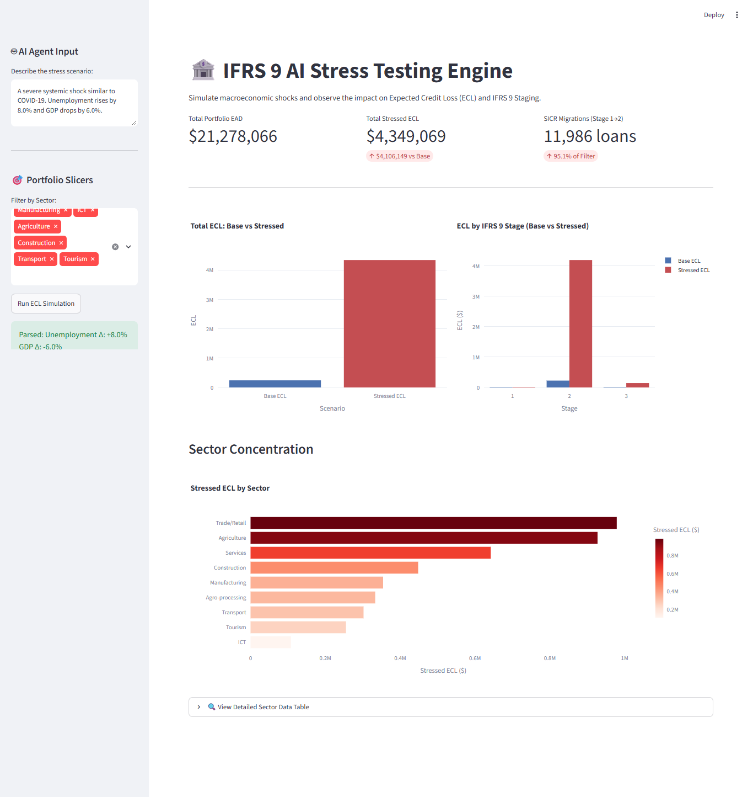
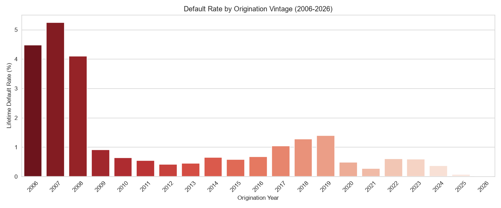
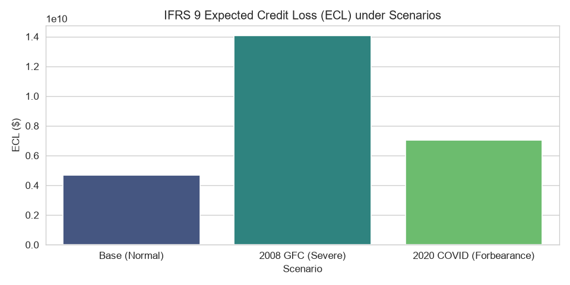

# IFRS9-Basel-Credit-Risk-Engine
An end-to-end IFRS 9 and Basel III Credit Risk Engine. Features Lognormal PD modeling, Survival Analysis, Vasicek De-cycling, and Monte Carlo simulations proving the Basel Granularity Adjustment.

# IFRS 9 & Basel Credit Risk Engine

**Author:** Raymomd Sibanda, FRM
**Objective:** An institutional-grade Credit Risk framework built in Python. This repository bridges the gap between **Accounting** (IFRS 9 Expected Credit Loss) and **Regulatory Solvency** (Basel III Capital). It includes Exploratory Data Analysis, Survival Modeling, Forward-Looking Scenarios, and Monte Carlo simulations to validate the Basel ASRF formula.

---

## Project 1: The Unified IFRS 9 & Basel Engine (Synthetic Portfolio)
Built from scratch using a 20,000-loan synthetic portfolio. This engine demonstrates the full mathematical lifecycle of credit risk.

### 1. Exploratory Data Analysis: Lognormal Distributions
We simulate the portfolio's Probability of Default (PD) and Exposure at Default (EAD) using **Lognormal distributions**. Unlike a normal distribution, the lognormal curve has a long right tail—meaning most loans are small and safe, but a small percentage are massive and highly toxic. This accurately reflects real-world credit portfolios.

### 2. IFRS 9 Expected Credit Loss (EL)
We implemented a full Survival Analysis engine to calculate the **Marginal PD** for each month (accounting for the fact that a loan must survive Year 1 to default in Year 2). We then applied IFRS 9 Staging rules (SICR triggers) to move loans from 12-month ECL to Lifetime ECL. 

### 3. Basel III Capital & De-cycling
Basel requires a **Through-the-Cycle (TTC) PD**, but our model outputs a **Point-in-Time (PIT) PD**. We used the Merton/Vasicek formula in reverse to mathematically strip out the current macroeconomic cycle, recovering the TTC PD. We then applied the Basel ASRF formula to calculate the 99.9% Worst-Case PD and the required Regulatory Capital.

### 4. Monte Carlo Convergence & Granularity Adjustment
The Basel ASRF formula assumes an infinite number of loans (Asymptotic Single Risk Factor). We ran 100,000 Monte Carlo simulations to prove this. 

**Small Portfolios (The Fat Tail):**
For highly concentrated portfolios (100 to 1,000 loans), the Monte Carlo VaR significantly overshoots the Basel formula because of *idiosyncratic risk* (a single default hurts a small portfolio massively). 

**Large Portfolios (The Convergence):**
As we scale to 5,000, 20,000, 100,000, and 500,000 loans, the idiosyncratic risk diversifies away, and the Monte Carlo distribution narrows and converges perfectly to the Basel closed-form math.

*This visually proves why Basel III mandates a Granularity Adjustment for banks with concentrated portfolios.*

---

## Project 2: AI Stress Testing Dashboard (Streamlit)
The crown jewel of this repository is an interactive **AI Stress Testing Engine**. Risk managers can type a macroeconomic scenario in plain English (e.g., *"A severe recession with unemployment rising by 8%"*). The AI parses the text, applies the Vasicek macro overlay, calculates the SICR migration, and outputs the new IFRS 9 ECL instantly.

---

## Project 3: Real-World Stress Test (Freddie Mac Dataset)
We applied the IFRS 9 framework to a real-world US mortgage portfolio spanning 2006 to 2026 (5.4 million records). 

### 1. Vintage Analysis & Underwriting Drift
Default rates for 2016-2019 vintages were anomalously high. By plotting the origination risk profile, we proved that lenders loosened underwriting standards (falling FICO, rising DTI) right before the cycle turned.

### 2. Historical Stress Testing (GFC vs. COVID)
We calculated the Expected Credit Loss under different historical shocks. The 2008 Global Financial Crisis caused a 3x spike in ECL, while the 2020 COVID shock had a moderate impact due to high FICO scores and policy interventions (CARES Act forbearance).

---

### 🚀 How to Run This Project
1. Clone this repository.
2. Install dependencies: `pip install -r requirements.txt`
3. Run the notebooks (`06_final_ifrs9_basel_model.ipynb`) to view the data generation, EDA, and Monte Carlo simulations.
4. Launch the AI Dashboard locally: `streamlit run app.py`

*Note: All model outputs, staging tables, and sensitivity analyses are automatically exported to the `outputs/summaries/` directory as CSV files for downstream reporting.*
